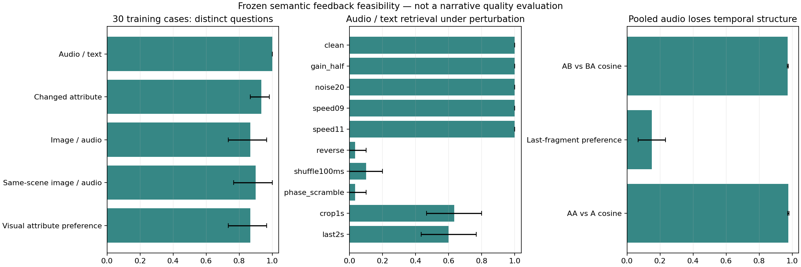

# Audio-semantic feedback: isolated feasibility before a temporal reader

The user proposal `SEMANTIC_LOOP.md` introduces a permanent visual anchor and a
separate audio representation of what the system actually pronounced. Both
EmbeddingGemma2 and Qwen stay frozen. A future small reader could generate a
second utterance from image plus previous audio, without a transcript, caption,
linguistic plan or ASR in inference. A native joint image/audio embedding is an
optional ablation, not a replacement for the permanent image representation.

This cycle implements an isolated media encoder and measures spoken semantic
feasibility before any neural training. Frozen protocol:
`configs/research/audio-feedback-feasibility.json`. The historical image encoder,
checkpoints and old results are unchanged. V25 and temporal-reader training are
not started. All96 fresh images remain reserved. The proposal is a hypothesis,
not an approved production architecture or a solved image narrator.

## Existing human diagnostic evidence

All18 OD clips are rated. Six exact stock/continuous controls have grounding4–5
and voice3, without incomprehensibility notes. All eight free-prior L2/L3/L4
controls have explicit full/partial gibberish notes and voice1. Four gold-history
oracle controls improve recognizable content, but three have explicit
pronunciation-error notes and voice1–2. Do not convert these scores into WER or
claim that nearest continuous candidates already preserve acceptable speech.
The failure at the continuous prior is now perceptually supported, with an
additional candidate-geometry/pronunciation limitation. The actual ratings and
private blind mapping are exported locally, not published.

## Phase0 contract

`FrozenFeedbackEncoder` is a new class. It loads the same pinned revision with
both media towers, in FP32 or explicitly supported BF16; FP16 is rejected.
Public APIs accept images, audio or paired media only. The pinned processor
constructs fixed modality markers automatically; no variable text parameter is
exposed. Runtime token IDs must be protocol markers or fixed joining whitespace.
Audio is downmixed and explicitly resampled to16kHz with no silent truncation.
Silent, nonfinite, too-short and over30-second histories are rejected rather
than confused with absent-history conditioning. The30-second bound is a pilot
resource limit, not the full model context limit.

Compare unchanged live/cached image vectors against the full-media image path,
repeated audio, duplicate and mixed-duration batches, and native joint media.
Record source, processor, weights/config revision, locked runtime, shapes,
normalization, dtype and peak memory. CPU mocks test boundaries; genuine GPU
smokes establish actual compatibility. No new library is needed: use installed
AutoProcessor/AutoModel and the existing worker audio stack.

The official [model card](https://ai.google.dev/gemma/docs/embeddinggemma/model_card_2)
and [multimodal guide](https://ai.google.dev/gemma/docs/embeddinggemma/multimodal-embeddinggemma-with-sentence-transformers)
document audio/image support and a shared768D output, while advising FP32/BF16
and no text prefixes on media. They do not establish fine Italian spoken-meaning
retrieval for this application; that is precisely the experiment.

## Phase1 decision rules

Thirty existing training cases are selected before inspecting scores, balanced
across10 scene categories and independent capture groups. Reuse genuine teacher
speech. Measure audio/text retrieval and image/audio retrieval separately, with
same-scene and minimal semantic negatives. Test controlled acoustic changes and
actual human-rated degraded speech. All text remains an offline reference.
Bootstrap source-image clusters rather than treating augmentations as independent.

The frozen JSON defines memory and critic thresholds separately. If broad
retrieval works but changed attributes fail, do not claim fine narrative memory.
If audio semantics works but visual grounding fails, consider memory only, not
an image critic. A scorer preferring gibberish is not an intelligibility filter.
Synthetic speaker-condition/timbre perturbations cannot certify robustness to
independent speakers. Human judgment remains required before promoting a
reranker or producing a continuation corpus for training.

## Exercised results, 2026-10-16

The audio representation passes the necessary numeric feasibility checks. It is
reasonable to test it as a memory input and a bounded candidate scorer. This is
not evidence of successful continuation, artistic quality, general speaker
robustness or M2 completion. The unchanged earlier Italian-stable V8/V9 recipe
is used for the no-training comparison; the failed V24 prior is not enlarged.

The pinned model is `google/embeddinggemma-2` at
`914f7f89142e33e77833254d9c9b90c3cef7303b`, with744,371,488 frozen parameters.
FP32 image vectors exactly match the unchanged live legacy encoder and cached
reference in the smoke test. Audio and native-joint batch discrepancies are
3.38e-6 and2.82e-6. The FP32 smoke peaks at4.89GB allocated, including the
second legacy model for parity. BF16 loads successfully and peaks at1.66GB,
but differs from FP32 image features by0.00182 and has audio/joint batch drift
up to0.00199. These are compatibility observations, not BF16 exact parity;
all semantic experiments and selection use FP32.

Thirty existing training utterances cover ten historical scenes and30 distinct
capture groups. Eighty additional diagnostic teacher WAVs cover changed
attributes, negations and two synthetic reference-voice conditions. All30
original text-projection prefixes match their historical teacher prefixes
bit-for-bit. No contrast waveform reaches its160-frame cap. The initial cache
contains912 vectors across28 groups, not912 independent examples.
The historical teacher sentences come from automatic visual annotations; their
per-image factual correctness has not been human validated. Retrieval agreement
with these references is not proof of faithful visual detail or artistic value.

| Question | Result | Uncertainty / interpretation |
| --- | ---: | --- |
| Audio→Italian reference,30-way |30/30 |Wilson95% lower bound88.65%; bootstrap at100% is degenerate |
| Balanced original/changed attribute matching |93.33% |Source-cluster bootstrap86.67–98.33% |
| Balanced negation matching |98.33% |95–100%; actual lexical realization needs separate validation |
| Image→audio,30-way |26/30 |73.33–96.67% |
| Image→audio within historical scene |27/30 |76.67–100% |
| Image prefers original over changed attribute audio |26/30 |73.33–96.67%; post-pilot diagnostic, no threshold retuning |
| Audio→English translation,30-way |30/30 |Assistant-authored translations, not human validated |
| Balanced English translated attribute matching |93.33% |86.67–98.33%; less direct Italian phonetic overlap |

An independent audio-only process reads a strict media/checksum manifest and
blocks other project-artifact reads with a Python audit hook. Its batched vectors
match the original audio cache exactly; singleton differences are at most
1.83e-5. No text module, teacher prefix or source image is read. This is a
scoped process-access check, not an operating-system sandbox claim.

Confirmation uses all170 existing training teachers against a fixed170-item
catalog. There are169 distinct reference strings and145 capture groups.
Strict diagonal audio/text top1 is166/170; counting identical strings as the
same positive yields168/170. On the140 examples outside the pilot, this is
138/140,98.57%, bootstrap96.45–100%, from119 capture groups. Four capture
groups overlap the pilot; this is additional-example confirmation, not an
independent held-out image test. Image/audio top1 is128/170. No teacher or
image in the reserved96-image set is accessed.

Gain,20dB noise, padding and the two speed perturbations retain30/30 audio/text
retrieval. Reversing audio and phase scrambling reduce it to1/30;100ms chunk
shuffling gives3/30. One-second and last-two-second crops give19/30 and18/30.
Synthetic reference perturbations retain content identity on ten cases each,
but use the same consented person and do not validate independent speakers.

An auxiliary lexical audit detects a recognizer-size limitation: Whisper Tiny
recognizes17/30 changed attributes and18/30 negation markers; Whisper Small
recognizes28/30 changed attributes and30/30 negation markers. Small's original
teacher word-edit ratio is10.77%, versus27.08% for Tiny. Both are fallible
recognizer measurements, not human intelligibility or artistic scores. The two
remaining attribute cases are unresolved. No case is removed, no score is used
for candidate selection, and no frozen threshold is changed. Whisper Small is
pinned at `973afd24965f72e36ca33b3055d56a652f456b4d` and runs locally in the same
worker; no audio is uploaded. All references and transcripts remain private.

The image/audio scorer prefers none of eight human-noted gibberish clips over
their exact reference controls. Those failures come from only two images;
the cluster-any-failure Wilson upper bound is about65.8%. This tiny check does
not establish a general intelligibility filter. Native joint embeddings also
retain substantial similarity to their shared image when the audio is wrong
(mean image cosine0.780 for same-scene wrong audio,0.814 matched). The candidate
critic therefore uses separate image and audio vectors, never joint/image
similarity that can reward the copied image condition.

### Memory order is a real limitation

Diagnostic concatenations A–pause–B, B–pause–A and A–pause–A are explicitly not
a narrative corpus. AB/BA embeddings have mean cosine0.9731; AA/A is0.9767.
The last-fragment preference is only15%, with a mean last-minus-first margin
around−0.047 in both orders. Full pooled audio is biased toward the first
fragment and cannot substitute for ordered narrative state. The initial
temporal design should encode the **last fragment separately**, preserve the
permanent image anchor, and carry explicit position/stop/history-present state.
The scores do not prove that the embedding can detect repetition or contradiction.



Error bars are fixed-catalog source-cluster bootstrap intervals. At0/100%, use
the additional Wilson bounds in the [aggregate JSON](validation/audio-feedback-20261016/summary.json)
rather than interpreting zero bootstrap width as certainty on unseen cases.

### Bounded no-training comparison, awaiting human assessment

The frozen protocol generates four candidates per each of eight existing
development images, plus four semantic-null candidates:36 genuine WAVs.
Seeds are42,41,43,44 with a160-frame cap and no adaptive retries. All36
candidates are eligible. Seed42 for the four original development cases exactly
reproduces the historical V9 WAV bytes. The scorer uses only normalized raw image
features and generated-audio embeddings. ASR runs afterward as an auxiliary
diagnostic and cannot select or filter a candidate.

Methods are first candidate, a hash-fixed random candidate, maximum image/audio
cosine, shuffled image scorer and zero scorer. The maximum differs from the first
candidate in6/8 cases; shuffling the scorer image changes its choice in4/8.
The image-conditioned maximum beats the null-pool maximum in6/8 cases, with a
mean cosine margin0.0163. These are internal dependence controls, not perceptual
improvements. Improving the optimized cosine is tautological.

All28 prespecified comparison pairs, including duplicate selections, are
ingested as `asfl-rerank-20261016`, **AF-01–AF-28**, in the existing authenticated
loopback gallery. No votes or quality judgments are generated. Human listening
must assess grounding and Italian clarity before any reranker promotion. A bad
candidate pool cannot be repaired by choosing its highest cosine.

## Reproduction and privacy

Private root: `artifacts/audio-feedback-20261016/`. Stage `*.command.json`
files contain the exact executed argv, source hashes and local-only inputs.
Diagnostic runs preserve original manifests and failed-attempt logs; follow-up
evaluations use new output directories rather than rewriting old results.
Contrast substitutions and translated references are private JSON inputs, never
hardcoded annotations in public source. Only aggregate statistics and plots are
published. The proposal file supplied by the user remains untouched locally.

Same worker image, locked Qwen interpreter for speech and separate locked vision
interpreter for the full media encoder:

```bash
make test
LD_WORKER_BASE_IMAGE=latent-diaries-worker:local DOCKER_CONFIG="$PWD/.cache/docker-config" \
  make DOCKER=.cache/tools/docker test-docker

DOCKER_CONFIG="$PWD/.cache/docker-config" .cache/tools/docker compose --profile gpu run --rm \
  -e LD_REF_TEXT= -v "$PWD/src:/workspace/src:ro" -v "$PWD/scripts:/workspace/scripts:ro" \
  experiment-gpu /opt/vision/.venv/bin/python scripts/confirm_audio_feedback_semantics.py \
  --dataset artifacts/paired-acoustic-v18/targets/dataset.json \
  --teachers artifacts/paired-acoustic-v18/teachers/manifest.json \
  --labels artifacts/instance-supervision-v17/labels.jsonl \
  --pilot artifacts/audio-feedback-20261016/benchmark/benchmark.json \
  --output-dir artifacts/audio-feedback-confirmation-reproduction

uv run --locked --script scripts/report_audio_feedback.py \
  --root artifacts/audio-feedback-20261016 \
  --output-dir artifacts/audio-feedback-aggregate-reproduction
```

For other stages use the corresponding script `--help` and the private exact
command manifest. Fresh directories are required to protect sealed evidence.
No new runtime dependency, host training, paid job, HF upload or media publication
is introduced. The local vision-labeling container was not needed and stays off.

## Next decision

V25 remains unstarted. Audio semantic feasibility is positive enough for this
bounded listening experiment, while sequential narrative competence is unproven.
After listening, either reject the critic or retain it as a diagnostic; do not
infer continuation quality from its cosine. Before temporal-reader training,
prepare a genuinely progressive two-fragment corpus and obtain the required
human subset validation. Compare image-only, image+last-audio, shuffled history
and absent-history with the same permanent image anchor. Keep first-fragment
intelligibility, history dependence, non-repetition and artistic grounding as
separate outcomes. No temporal training or continuation corpus is started here.
