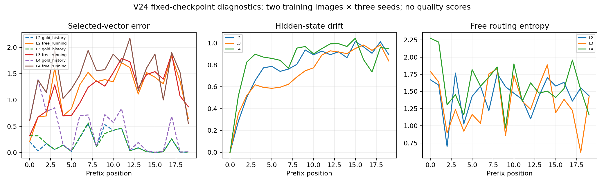
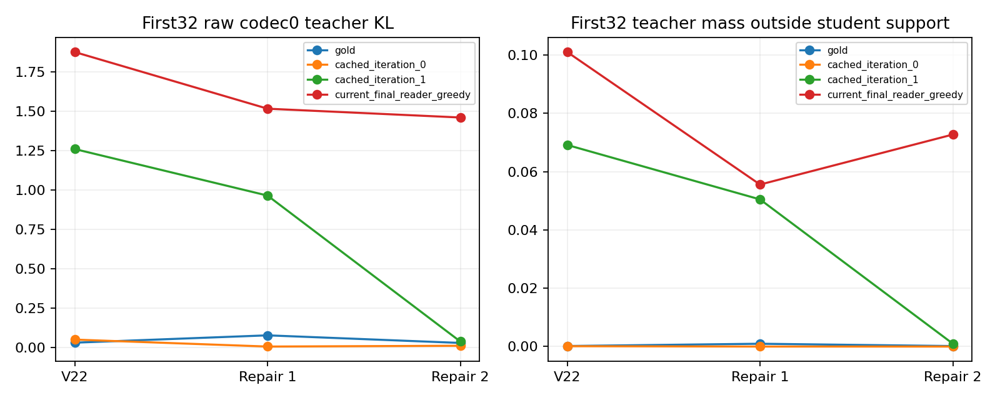
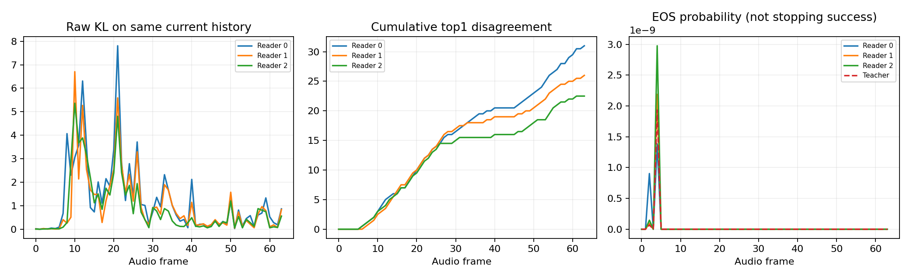

# Independent review response and diagnostic recovery

**Follow-up, 2026-10-16:** all18 OD clips are rated. Exact controls are clear;
all eight free-prior controls have explicit gibberish notes, and the gold-history
oracle controls retain pronunciation errors. This supports the prior diagnosis
but does not establish an intelligible candidate geometry. V25 remains unstarted.
The new [audio-semantic feedback investigation](AUDIO_SEMANTIC_FEEDBACK_LOOP.md)
records a separate frozen-encoder hypothesis, actual feasibility evidence and
an unpromoted28-pair listening comparison. Historical diagnostics below remain
unchanged; their earlier listening request is now completed.

The reviewed source is `47d304985647e5bc77704b0a5cb29e5e4f740c2e`.
The user-supplied review has SHA256
`77859c0d8b36875a5bcb564d2882e39b7e75e7941e15466060d16dc3b67ca3d6`.
This response adds evidence without rewriting historical experiments. No neural
training, paid job, private upload or reserved-image access is performed. The
offline ridge-CV characterization fits temporary linear coefficients only; it
never replaces an adapter or checkpoint.

## Finding register

| ID | Classification | Location | Verification and consequence |
|---|---|---|---|
| R01 | confirmed bug | `scripts/evaluate_autoregressive_prior.py`, historical affine-null branch; `scripts/train_autoregressive_prior.py:210` | Historical `null` was normalized adapter bias, whereas robust training uses exact semantic zero. Separate three explicit controls; preserve `--legacy-null`. Existing ratings remain historical, not recalculated. |
| R02 | confirmed bug | `scripts/evaluate_autoregressive_prior.py:50` | The mode flag formerly asserted image provenance without verifying input vectors. Now image mode requires original image encoder cache manifests/tensors and exact identity/vector checks; text mode requires its distinct corpus-bound text cache. Regression rejects text-cache relabeling and modified image vectors. This is local provenance, not cryptographic attestation against forged source caches. |
| R03 | verified limitation | `scripts/train_policy_repair.py:198` | Bernoulli source sampling is not image-balanced. Actual logs give811 rollout/789 gold steps per1600-step stage. Sixty rollout members average18.52 exposures; other110 images average4.45, including one never sampled. Both stages reuse the same sampling sequence. This was a design choice, not an optimizer implementation failure. |
| R04 | methodological risk | `scripts/cache_student_histories.py`; V23 frozen caches | Fitting old histories does not establish current-policy stability. Compare V22, first repair and second repair on identical cached/current histories; match current codec0-greedy generation to cached V23 decoding before interpreting staleness. |
| R05 | verified limitation | `src/latent_diaries/multihypothesis_prior.py:75` | Best-of-modes reconstruction and routing loss use gold previous vectors. The real sampler at line33 uses generated previous vectors. Existing V24 traces directly measure the resulting drift, without changing training. |
| R06 | hypothesis | `src/latent_diaries/prior_diagnostics.py:6` | Routing/exposure bias is a candidate mechanism, not a proven sole cause. Gold-history, free-run and every single-vector oracle reset distinguish some effects; four additional gold-history routed/best-candidate WAVs test whether candidate geometry is already inadequate. |
| R07 | methodological risk | `scripts/fit_semantic_image_adapter.py`; semantic D1/D2/D3 | In-sample cosine/retrieval is not held-out grounding. Characterize exact sentences, oracle means and predictions separately. All means exclude language-held-out rows. |
| R08 | not reproducible | Offline extended ridge grid | The concern that alpha1.0 was only preferred because it sat at the old upper boundary is not supported here:10 and100 worsen the same training-group CV objective. Historical adapter is unchanged. This does not prove semantic adequacy. |
| R09 | methodological risk | `src/latent_diaries/inversion.py:90`; decoding processors | Raw KL omits support truncation. Capture processor order and initial ID context from actual installed generation; compare processed policies on identical histories. Report infinite exact KL separately from clamped numerical summaries. |
| R10 | verified limitation | `src/latent_diaries/grounded_corpus.py:4`; `scripts/augment_private_narratives.py:80` | Validation checks syntax/length/protocol markers, not visual truth. Small seeded local vision re-audit is diagnostic only; it never creates training labels. Automated judges remain fallible and correlated with augmentation. |
| R11 | hypothesis | `src/latent_diaries/vision.py:38`; image-query reader | Global masked pooling may lose useful local information. Installed upstream `get_image_features` applies `embed_vision` and splits nonpadding projected states; `image_hidden_states` are not interchangeable with raw tower outputs. No patch-token/resampler training is justified while exact semantic inputs already fail. |
| R12 | verified limitation | V24 prior configuration | The output subspace grows512→768 and parameter count9.41M→13.64M. V24 does not isolate narrative quantity as its only changed variable. |
| R13 | methodological risk | Historical seed42 and repeated development | New ladder uses41/42/43 with fixed checkpoints/speaker/decoding. Two annotated training images and one exposed image-only development control are not a generalization benchmark. |
| R14 | verified limitation | V24 corpus and sampling | Uniform2437 training-utterance sampling gives1157 image-specific rows and1280 replay rows. Only168 independent image groups exist; paraphrases do not add independent visual contexts. |
| R15 | hypothesis | Qwen as implicit language generator | Continuous-prefix memorization does not demonstrate open-ended language generation. No alternative backbone is declared operational, and no V25 training is authorized by this review. |

Tests: `test_semantic_adapter.py` checks all three exact control vectors;
`test_feature_provenance.py` checks origin boundaries;
`test_prior_diagnostics.py` checks real-sampler parity and causal intervention;
`test_policy_diagnostics.py` checks selected-action loss and support-induced
infinite KL. Existing real-Qwen tests retain prefix/trailing replacement,
shift/mask/EOS/gradient and actual generation/replay coverage.

## Oracle ladder protocol and artifact inventory

Frozen protocol: `configs/research/oracle-audit-20261016.json`. Existing V24
robust32 prior, original adapter and frozen backbones remain fixed. Two existing
training images from different categories, three seeds41/42/43, FP32, same fixed
speaker and160-frame cap. The48 actual WAVs comprise L0–L4 for each image/seed,
three explicit null/mean controls, cyclic shuffled images, and one image-only
exposed-development control. Oracle text is restricted to the training images.

L0 uses stock Qwen with exact training text. L1 uses its exact cached continuous
prefix. L2 uses the exact training sentence's EmbeddingGemma vector. L3 uses its
image group's normalized training-only narrative mean. L4 uses the unchanged
image adapter prediction. L5 separates missing image from missing semantics.

The four supplemental oracle WAVs hold gold previous vectors and compare learned
routing to an oracle best-candidate selection. They use target information and
are explicitly NOT deployable inference. They were added after the initial traces
showed a routing/closed-loop gap; this is an isolated diagnosis, not model tuning.

Private root: `artifacts/oracle-audit-20261016/`. Exact invocations are saved in
`*.command.json`; `ladder/results.json` records revisions, checkpoint/cache and
source hashes, seed, precision, decoding, speaker checksum and offline-text scope.
`ladder/prior-traces.json` records all18 aligned traces and every single-position
intervention. Aligned traces deliberately ignore stopping for comparison; actual
WAV generation retains original stopping. `representation.json` contains D1/D2/D3
geometry. `sampling-complete.json` contains actual sampling counts including
zero-exposure images. `policy-matched/policies.json` contains raw/effective audio
policies. `oracle-controls/results.json` explicitly marks its oracle-only scope.
ASR manifests are auxiliary and local; they are never quality scores.

## Discriminating results

L0/L1 input embeddings, attention masks, trailing conditioning and PAD embeddings
are numerically identical. All six paired L0/L1 WAVs are byte-identical. There is
no observed loss at the exact-text→continuous-prefix interface in this sample.
This does not certify arbitrary learned prefixes or new language generalization.

For the V24 prior, means below give equal weight to each image/seed case:

| Input | Gold-history selected prefix MSE | Free-run selected MSE | Gold routing selects closest candidate | Free routing selects closest candidate |
|---|---:|---:|---:|---:|
| L2 exact sentence semantics |0.1887|1.1947|86.4%|22.4%|
| L3 oracle narrative mean |0.1984|1.1639|84.9%|25.5%|
| L4 image-adapter prediction |0.4064|1.4390|73.3%|12.8%|

The gold-history *best-candidate* errors are0.0554/0.0561/0.0704 respectively.
Even the best single oracle reset leaves free-run mean error0.9282/0.8544/1.1986;
one repaired position does not restore the entire sequence. These are diagnostic
reconstruction metrics, not intelligibility, WER or artistic judgments. Best-mode
agreement means agreement with the nearest continuous target, not word accuracy.

Across168 training images, mean D1↔D2 cosine is0.97294 and D2↔D3 cosine0.94793;
D3 pre-normalization norm averages0.91040. Own-image retrieval is88.1% against
all2437 training sentence vectors and82.1% against178 group means (168 image
and10 replay categories). These are IN-SAMPLE adapter diagnostics. The same
five-fold training-group CV scores for alpha1/10/100 are0.18293/0.20934/0.22119.
No adapter or checkpoint is changed by extending this grid.

Auxiliary ASR on the exact-prefix controls consistently retains their known
Italian wording, while many L2 outputs are already fragmented despite exact
training sentence semantics. The first supported *numerical/auxiliary* failure
is therefore the continuous prior before visual adaptation. Human confirmation
of the listening boundary remains required; a low cosine error cannot certify
speech. The adapter adds another loss, but visual pooling is not needed to
explain this earlier failure. A patch-token speech run is therefore deferred.

## Narrative audit and limits

The seeded audit samples six already annotated training images and five existing
training variants per image. It assesses visible-detail preservation, relations,
paraphrase consistency, Italian naturality and narrative specificity. The local
vision judge flags12/30 variants as possibly altering details/relations; this is
NOT ground truth or a measured human hallucination rate. Some judge explanations
are themselves ambiguous. It reports little semantic diversity in most groups.
Across all1157 image-specific training narratives there are13399 word tokens and
1209 normalized word types (type/token0.0902); that lexical statistic does not
measure narrative originality. The same reported model family produced the
augmentation, so this audit is not an independent-model validation. No annotation
is added to training and the service is stopped in `finally`.

## Reproduction

Use the managed Compose worker with `LD_REF_TEXT=` and a source revision. Run
`scripts/oracle_ladder.py --run-dir artifacts/grounded-language-v24/robust32
--corpus-dir artifacts/grounded-language-v24/corpus --features-dir
artifacts/grounded-language-v24/features --adapter-dir
artifacts/grounded-language-v24/adapter --dataset
artifacts/private-photos-002/targets/dataset-expanded.json --image-cache
artifacts/private-photos-001/features-001 --image-cache
artifacts/private-photos-002/features --ids p0003 p0006 --development-ids q0052
--seeds 41 42 43 --max-frames 160 --output-dir <fresh-private-dir>`.
Use the stage command manifests for the corresponding policy, oracle-supplement,
ASR and sampling controls. Do not rerun into historical output directories.

For future `evaluate_autoregressive_prior.py` invocations, image mode now requires
both original `--image-cache` directories. Training-text diagnostics instead
require `--text-cache <matching-training-cache>` and cannot attach an image
adapter. Default `null` is semantic zero. `--legacy-null` reproduces the previous
zero-image-through-affine meaning. `--diagnostic-controls --training-mean
<verified-training-mean.safetensors>` adds all three named controls. None of
these options updates old WAVs, manifests, ratings or checkpoints.

The plotting-only host command is `uv run --locked --script
scripts/report_oracle_audit.py --audit-dir artifacts/oracle-audit-20261016
--policy-dir policy-matched`. Its separate script lock pins Matplotlib3.10.7
and dependencies; it reads JSON and loads no ML models. All ML computation,
training-free inference and tests use the same locked Docker worker.

## Closed-loop audio-policy analysis

Two training cases are scored on identical gold, cached and current histories
using frozen Qwen and each of the three existing visual-reader states. The
current rollout is also generated with codec0 greedy/sampled residuals to match
V23's cache protocol. Score only the first32 codec0 positions for the table,
excluding the appended counterfactual EOS row and unequal history lengths.

| History | V22 raw KL | Repair1 raw KL | Repair2 raw KL |
|---|---:|---:|---:|
| Gold |0.0303|0.0769|0.0287|
| Original cache |0.0498|0.0057|0.0107|
| Second cache |1.2599|0.9644|0.0375|
| Current final-reader greedy rollout |1.8759|1.5162|1.4603|

The final reader's current greedy histories leave mean7.27% teacher probability
mass outside student top-k support; on its second cache this is0.10%. Teacher
and student always see the same previous audio codes for each comparison.
The actual codec0 processor order is repetition penalty, minimum length,
minimum new tokens, protocol suppression, temperature and top-k. Residual heads
use temperature and top-k; they remain sampled even with greedy codec0.
Support differences can make exact truncated-policy KL infinite. The report
therefore separates lost mass/infinite support mismatch from KL clamped at1e-30;
these clamped numbers must not be represented as exact finite KL.

Actual sampled-generation/replay checks give codec0 raw differences at most
5.34e-5, processed finite-score differences6.10e-5, and identical processed
support. Residual raw differences reach1.34e-4; this is reported as observed
FP32 accumulation, not silently rounded down to the earlier codec0 tolerance.
EOS probabilities and cumulative codec0 disagreements are preserved per frame.
EOS probabilities after a capped or arbitrary history do not establish successful
stopping. Both original V23 caches used batch8 generation; current controls use
batch1. Residual random draws therefore differ even at the same seed. This
limits attribution to cache age alone, although the same-history policy
comparisons directly establish the failure to cover current trajectories.

The result supports stale/sparse-history coverage as a remaining risk and rejects
the claim that the two repair iterations eliminated exposure bias. It does NOT
prove that more repair iterations, reweighting or a larger adapter would work.

## Human gate and proposed next experiment

Eighteen genuine blinded diagnostic clips are imported as
`oracle-diagnostic-20261016`, labels **OD-A–OD-R**, at the existing authenticated
loopback review service. They contain offline oracle controls and are explicitly
NOT an image-only candidate gallery. No rating was created. The selection
includes both training images across L0–L4, L1/L2 seed controls for one image,
and all four gold-history routed/best-candidate supplements. Inspect Italian
intelligibility and audible slips first; image grounding remains a separate
question. Notes can state `italiano comprensibile`, `parziale`, or
`incomprensibile`, plus where the content breaks down. Do not score these oracle
controls as evidence that an autonomous image narrator has succeeded.

The numerical/auxiliary evidence points first to continuous-prior generation,
with an additional adapter loss; perceptual confirmation is pending. Phase D
patch-token/resampler work is deferred because it cannot explain failure at L2.
[The single V25 proposal](PROPOSAL_V25.md) tests fresh on-policy continuous-prior
histories, holding corpus, subspace, width, modes and acoustic/visual backbones
fixed. It is conditional on listening and explicit instruction; it is not run.
The earlier Italian-stable reference is preserved. M2 remains unaccepted.

A final standalone image-only evaluator run loads no corpus, training text
features or teacher tensors. All four WAVs (two training-image controls, exposed
development and exact semantic-null) are byte-identical to their ladder
counterparts at seed42. Its manifest records the verified original image caches,
`text_used=false`, `teacher_files_read=false`, `linguistic_labels_read=false`
and `null_control=zero_semantic_after_adapter`. This separates co-located oracle
diagnostics from the actual autonomous image path. It establishes parity, not
an intelligibility improvement.
